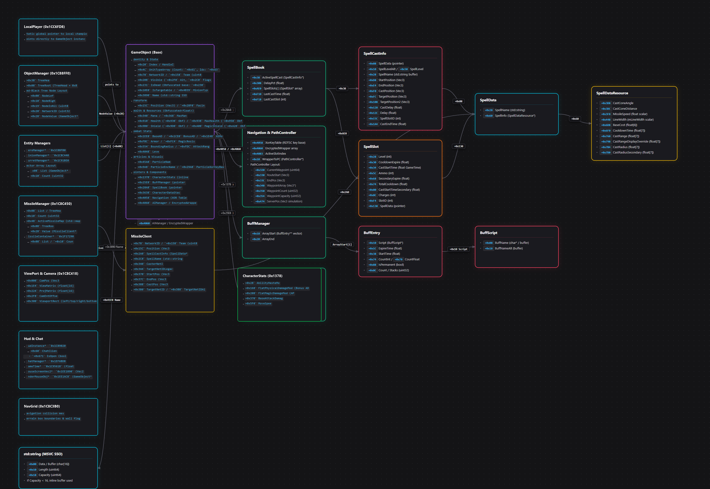

<h1 align="center">League — Offset & Pattern Database</h1>

<p align="center">
  
  
  
  
</p>

<p align="center">
  <strong>Star For Support ⭐</strong><br>
  Core RVA offsets, patterns, and structure layouts reversed from the game client.
</p>

## Repository Layout

```
League-Offsets/
├── assets/
│   └── offset_tree.png        ← visual memory architecture tree
├── src/
│   ├── offsets.hpp            ← clean C++ header with essential core offsets
│   ├── offsets.json           ← JSON dump of resolved RVAs & member offsets
│   └── quick_usage/           
│       └── all_offsets.hpp    ← example single header demonstrating reading core entities
```

## Memory & Offset Architecture Tree

<p align="center">
  
</p>

## Build Info

| Field | Value |
| ----- | ----- |
| Patch | 26.21 |
| Timestamp | `6AC5F0E0` |
| Imagebase | `7FF69A1B0000` |
| Compiler | Visual C++ · x64 PE |

---

## Contact
Discord — **swansizz**  
Or open an [issue](../../issues) if a pattern is missing or broken.
